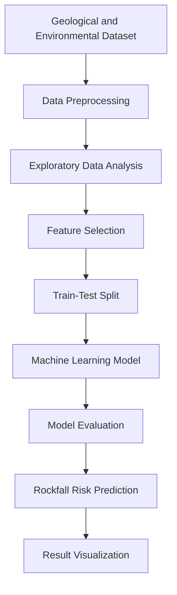

# 🪨 Rockfall Prediction System Using Machine Learning

## 📌 Project Overview

The Rockfall Prediction System is a Machine Learning-based project designed to analyze geological and environmental factors to predict potential rockfall risks.

The system applies data preprocessing, exploratory data analysis, and predictive modeling techniques to identify risk patterns and assess the possibility of rockfall events. It aims to support early risk identification, disaster management, and infrastructure safety.

## 🎯 Objectives

- Analyze geological and environmental data.
- Identify factors influencing rockfall events.
- Predict potential rockfall risks using Machine Learning.
- Visualize rockfall risk patterns.
- Support disaster prevention and safety management.

## ✨ Key Features

- **Data Preprocessing:** Cleans and prepares geological and environmental datasets.
- **Exploratory Data Analysis:** Identifies patterns and relationships between risk factors.
- **Rockfall Prediction:** Uses Machine Learning techniques to estimate rockfall risk.
- **Risk Factor Analysis:** Analyzes factors contributing to rockfall events.
- **Data Visualization:** Represents geological and environmental patterns through charts and graphs.
- **Model Evaluation:** Evaluates the performance of the prediction model.

## 🛠️ Tech Stack

| Technology | Purpose |
|---|---|
| Python | Programming language |
| Pandas | Data manipulation and analysis |
| NumPy | Numerical computations |
| Matplotlib | Data visualization |
| Scikit-learn | Machine Learning model development |
| Visual Studio Code | Development environment |
| Git & GitHub | Version control |

## ⚙️ Project Workflow

## 🔄 Working Principle

1. Collect geological and environmental data.
2. Clean and preprocess the dataset.
3. Analyze the factors influencing rockfall events.
4. Select relevant features for prediction.
5. Train the Machine Learning model.
6. Evaluate the model's performance.
7. Predict potential rockfall risks.
8. Visualize and interpret the prediction results.

## 📊 Potential Rockfall Risk Factors

- Rainfall intensity.
- Slope angle.
- Soil moisture.
- Temperature variations.
- Rock and soil characteristics.
- Ground vibrations.
- Historical rockfall occurrences.

## 🌐 Applications

- Open-pit mining safety.
- Mountain road safety management.
- Geological hazard monitoring.
- Disaster risk management.
- Construction site safety.
- Infrastructure protection.
- Environmental monitoring.

## 📚 Learning Outcomes

- Data cleaning and preprocessing.
- Exploratory Data Analysis (EDA).
- Machine Learning model development.
- Feature selection and engineering.
- Predictive analytics.
- Risk assessment.
- Model training and evaluation.
- Data visualization.

## 🚀 Future Enhancements

- Real-time rockfall monitoring using IoT sensors.
- Weather API integration.
- GPS-based risk location mapping.
- Automated early warning notifications.
- Deep Learning-based risk prediction.
- Interactive risk monitoring dashboard.
- Satellite imagery and GIS integration.

## 📖 Project Status

This project demonstrates the application of Artificial Intelligence and Machine Learning in geological hazard prediction. It is an academic prototype and requires field validation before use in safety-critical environments.

## 👩‍💻 Developer

**Kiruthika Loganathan**

- B.Tech – Artificial Intelligence and Data Science
- KPR Institute of Engineering and Technology
- GitHub: [kiruthika569](https://github.com/kiruthika569)

---

⭐ If you find this project interesting, consider giving the repository a star!

**Rockfall Prediction System – Leveraging Artificial Intelligence for Safer Environments.**
